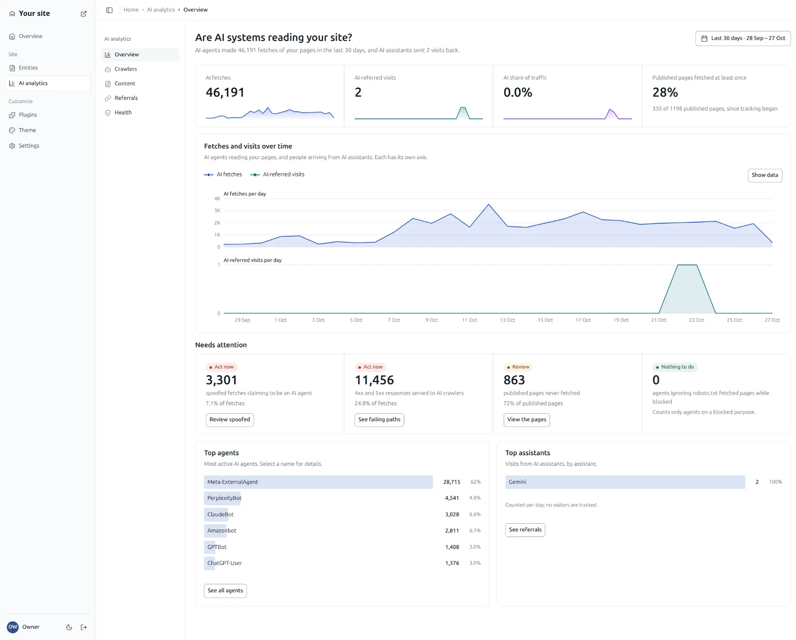
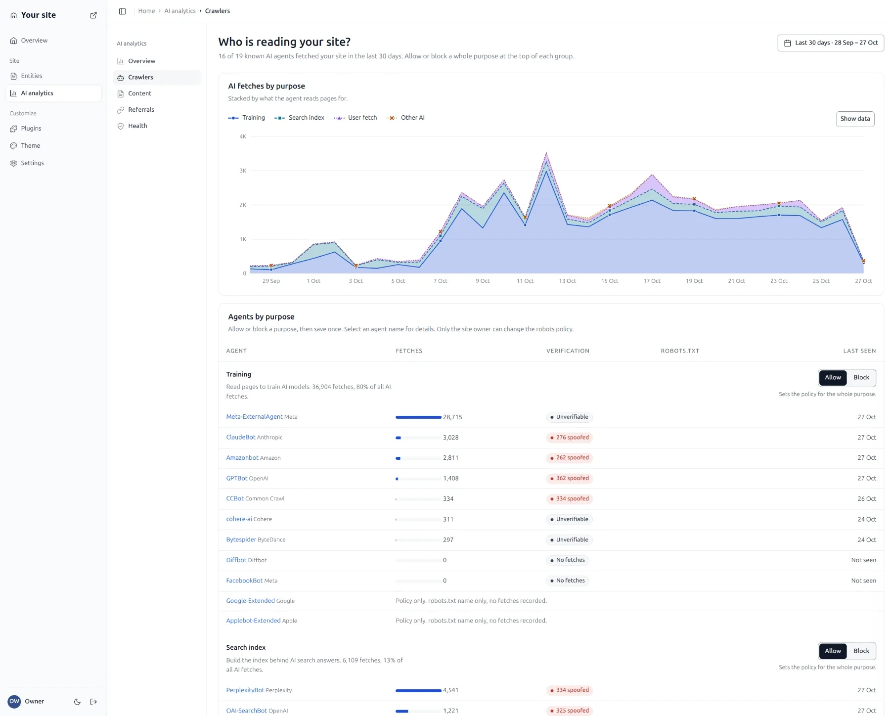

<h1 align="center">Hatamoto</h1>

<p align="center"><strong>Stand close. Serve well.</strong></p>

<p align="center">
The batteries-included CMS for the agentic era: builder, SEO, caching, forms, redirects,
AI analytics and MCP in one Go binary plus Postgres.<br>
Open source, no plugin stack, no PHP, no Node, no telemetry.
</p>

<p align="center">
  <a href="https://hatamoto.dev">Website</a> ·
  <a href="https://hatamoto.dev/docs">Docs</a> ·
  <a href="docs/site/getting-started/index.md">Get started</a> ·
  <a href="https://hatamoto.dev/plugins">Plugins</a> ·
  <a href="https://hatamoto.dev/themes">Themes</a> ·
  <a href="docs/ROADMAP.md">Roadmap</a> ·
  <a href="SECURITY.md">Security</a>
</p>

## Get started

**Docker** (starts Postgres too):

```sh
git clone https://github.com/Zen-Labs-Corp/hatamoto.git && cd hatamoto
docker compose up
```

**Or the binary** (Linux or macOS, Intel or ARM), pointed at your own Postgres:

```sh
OS=$(uname -s | tr A-Z a-z); ARCH=$(uname -m | sed 's/x86_64/amd64/; s/aarch64/arm64/')
curl -fL "https://github.com/Zen-Labs-Corp/hatamoto/releases/latest/download/hatamoto-$OS-$ARCH.tar.gz" | tar -xz --strip-components=1 "hatamoto-$OS-$ARCH/hatamoto"
DATABASE_URL=postgres://user:pw@localhost:5432/hatamoto?sslmode=disable ./hatamoto serve
```

Open **http://localhost:8090/admin**. The setup code is printed in the server logs
(`docker compose logs hatamoto`). More: [Install with Docker](docs/site/getting-started/install-docker.md),
[Install the binary](docs/site/getting-started/install-binary.md), [First run](docs/site/getting-started/first-run.md),
[Trust and signing](docs/site/updates/trust-and-signing.md).

> **Status: pre-1.0, plugin SDK v0.** It runs [hatamoto.dev](https://hatamoto.dev) in production, but the SDK and
> some APIs can still change between minor versions. What stays stable: [STABILITY.md](STABILITY.md).



<!-- OWNER: screenshot, the page editor:  -->
<!-- OWNER: screenshot, the WordPress import report:  -->

## Features

- A fast, server-rendered site with a good default theme, a blog and pages.
- A proper **blog editor** and a visual **page editor**. [Admin guide](docs/site/admin/index.md)
- **WordPress import** that keeps every old URL working, with a URL audit. [Move your site](docs/site/migrate-contribute/wordpress-import.md)
- **AI-crawler analytics** (which AI read which page, and did it send visitors), `llms.txt`, JSON-LD and a knowledge graph. [AI and SEO](docs/site/ai-seo/index.md)
- Sandboxed one-click **plugins** and **themes** (WebAssembly), nothing to compile. [Plugins](docs/site/plugins/index.md), [Themes](docs/site/themes/index.md)
- An **MCP server**, so AI agents can write and publish through the CMS. [MCP](docs/site/ai-seo/mcp.md)
- Signed releases with automatic updates you control. [Updates](docs/site/updates/index.md), [docs/UPGRADES.md](docs/UPGRADES.md)



## Run it in production

| Topic | Read |
| --- | --- |
| Hardening (HTTPS, HSTS, CSP, secrets, SMTP) | [Hardening](docs/site/operate/hardening.md) |
| Every environment variable | [Configuration reference](docs/site/operate/configuration-reference.md) |
| Every `hatamoto` command | [CLI reference](docs/site/operate/cli-reference.md) |
| Reverse proxy and TLS | [Reverse proxy and TLS](docs/site/operate/reverse-proxy-tls.md) |
| systemd or Docker | [Deploy with systemd](docs/site/operate/deploy-systemd.md), [Deploy with Docker](docs/site/operate/deploy-docker.md) |
| Backups and updates | [Backups](docs/site/operate/backups.md), [Updates](docs/site/updates/index.md) |

No telemetry, no usage reports. Every connection the server makes, with the switch that turns it off, is listed in
[Outbound connections](docs/site/operate/outbound-connections.md). Updates can stop entirely: set `HATAMOTO_UPDATES`
to `off` (no network call at all).

## Contribute

Go is the only toolchain: `make build`, `make check`, and `go test ./...` from `backend/`.
Read [CONTRIBUTING.md](CONTRIBUTING.md) and the [Code of Conduct](CODE_OF_CONDUCT.md), and report security
problems privately as described in [SECURITY.md](SECURITY.md). Write a plugin: [plugin guide](docs/PLUGINS_WRITE_AND_SUBMIT.md);
write a theme: [theme guide](docs/THEMES_WRITE_AND_SUBMIT.md).

## Licence

[Apache-2.0](LICENSE). Copyright Zen Labs Corporation; third-party components in [NOTICE](NOTICE).
"Hatamoto" and its logo are trademarks of Zen Labs Corporation: forks must use a different name.
See [TRADEMARKS.md](TRADEMARKS.md).
