<p align="center"></p>

<h1 align="center">Hatamoto</h1>

<p align="center"><strong>Stand close. Serve well.</strong></p>

<p align="center">
The batteries-included CMS for the agentic era: builder, SEO, caching, forms, redirects,
AI analytics and MCP in one Go binary plus Postgres.<br>
Open source, no plugin stack, no PHP, no Node, anonymous install stats on by default, one switch to turn them off.
</p>

<p align="center">
  <a href="https://github.com/Zen-Labs-Corp/hatamoto/actions/workflows/ci.yml"></a>
  <a href="https://github.com/Zen-Labs-Corp/hatamoto/releases/latest"></a>
  <a href="LICENSE"></a>
</p>

<p align="center">
  <a href="https://hatamoto.dev">Website</a> ·
  <a href="https://hatamoto.dev/docs">Docs</a> ·
  <a href="docs/README.md">Docs in this repo</a> ·
  <a href="docs/site/getting-started/index.md">Get started</a> ·
  <a href="https://hatamoto.dev/plugins">Plugins</a> ·
  <a href="https://hatamoto.dev/themes">Themes</a> ·
  <a href="docs/ROADMAP.md">Roadmap</a> ·
  <a href="SECURITY.md">Security</a>
</p>

<p align="center">
  <picture>
    <source media="(prefers-color-scheme: dark)" srcset="docs/images/builder-dark.webp">
    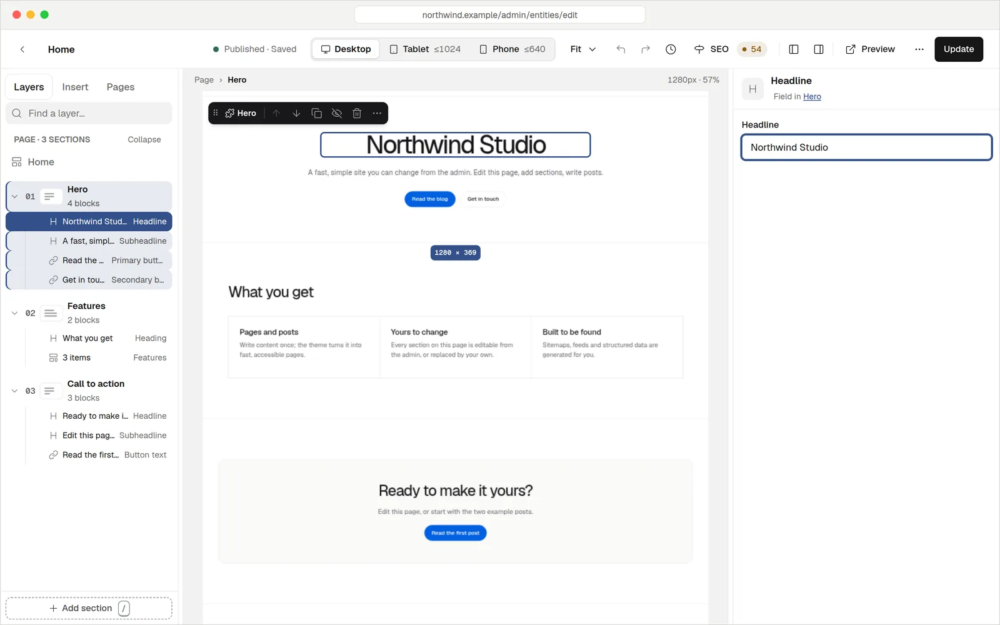
  </picture>
</p>

## Get started

**Docker** (starts Postgres too):

```sh
git clone https://github.com/Zen-Labs-Corp/hatamoto.git && cd hatamoto
docker compose up
```

**Or the binary** (Linux or macOS, Intel or ARM), pointed at your own Postgres:

```sh
OS=$(uname -s | tr A-Z a-z); ARCH=$(uname -m | sed 's/x86_64/amd64/; s/aarch64/arm64/')
curl -fL "https://github.com/Zen-Labs-Corp/hatamoto/releases/latest/download/hatamoto-$OS-$ARCH.tar.gz" | tar -xz --strip-components=1 "hatamoto-$OS-$ARCH/hatamoto"
DATABASE_URL=postgres://user:pw@localhost:5432/hatamoto?sslmode=disable ./hatamoto serve
```

The server prints a setup address in its log (`docker compose logs hatamoto`). Open it to create
your account and site. The admin lives at a private address of its own, which `hatamoto admin-url`
prints at any time. More: [Install with Docker](docs/site/getting-started/install-docker.md),
[Install the binary](docs/site/getting-started/install-binary.md), [First run](docs/site/getting-started/first-run.md),
[Trust and signing](docs/site/updates/trust-and-signing.md).

> **Status: v1, plugin SDK v0.** It runs [hatamoto.dev](https://hatamoto.dev) in production. The plugin SDK
> can still change between its minor versions. What stays stable, and for how long: [STABILITY.md](STABILITY.md).

## A look around

Every screenshot below is a real Hatamoto server with a seeded demo site, captured by
[`scripts/homepage-shots`](scripts/homepage-shots/README.md) (`SHOTS_SET=readme`), so they are regenerated
when the admin changes.

### Write and build pages

Posts get a writing editor with SEO checks, scheduling and suggested internal links. Pages get the visual
builder above: sections and blocks you rearrange on a canvas, previewed at desktop, tablet and phone sizes,
with undo, history and keyboard shortcuts. [Page editor](docs/site/admin/page-editor.md),
[Builder reference](docs/site/admin/builder-reference.md)

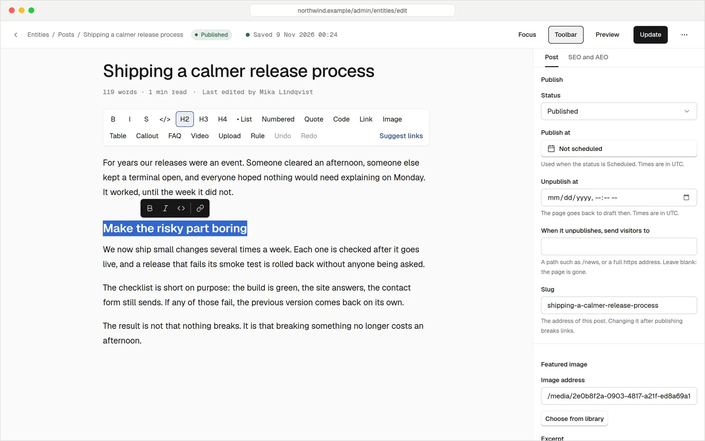

### See who reads your site, people and AI

The overview shows what changed this week and what needs a look. Analytics are cookieless and count AI
assistants as a channel of their own. The crawler report shows which AI agents fetch which pages, checks that
each one is who it claims to be, and lets you allow or block a whole purpose (training, search, user fetches).
[AI and SEO](docs/site/ai-seo/index.md), [Crawler analytics](docs/site/ai-seo/crawler-analytics.md)

<table>
  <tr>
    <td width="50%">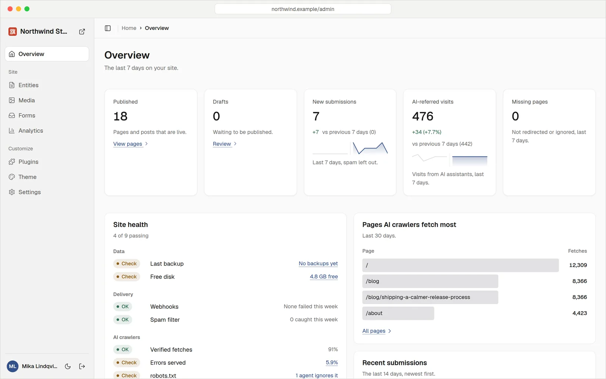</td>
    <td width="50%">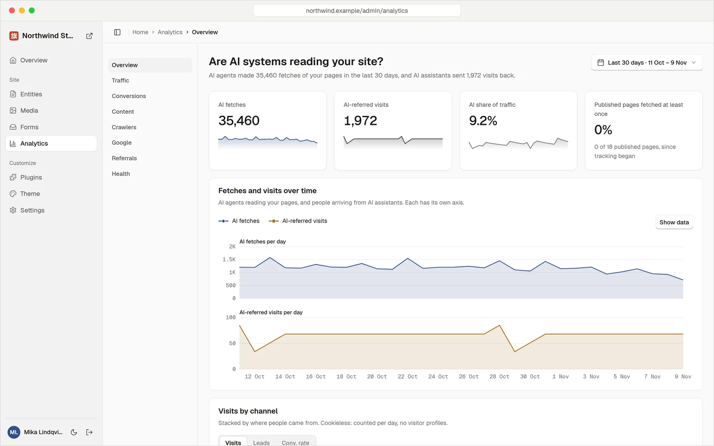</td>
  </tr>
</table>

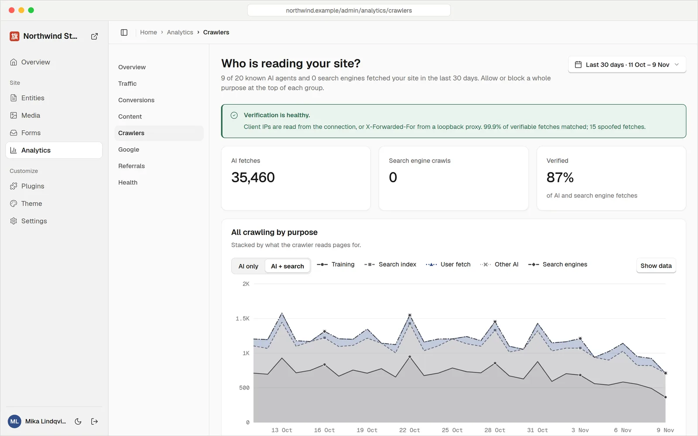

### Let agents publish through MCP

Hatamoto is an MCP server. An agent connects with an API key and gets tools for content, the page builder,
media, SEO and analytics, limited to the scopes on its key. This session is real: the agent drafts a post,
publishes it, and the page is live. [MCP](docs/site/ai-seo/mcp.md), [Connect an AI agent](docs/site/ai-seo/connect-an-ai-agent.md)

<table>
  <tr>
    <td width="50%">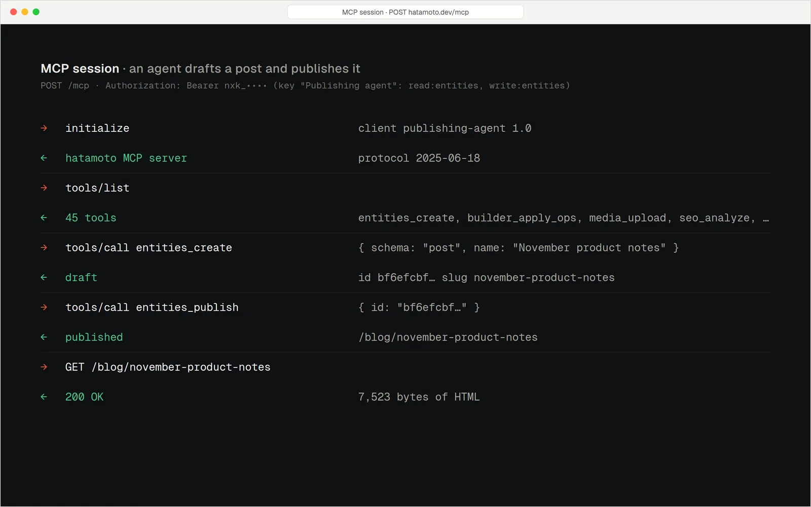</td>
    <td width="50%">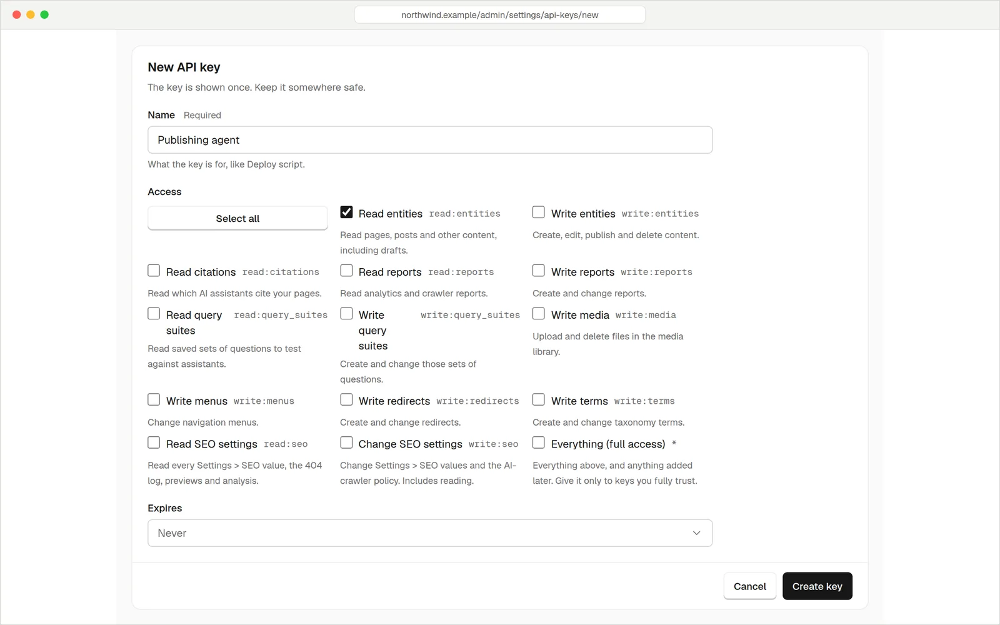</td>
  </tr>
</table>

### Move from WordPress without losing a URL

Point the importer at a WordPress export and it reports what it found before anything changes: content,
permalinks and the URL pattern that keeps them, the SEO plugin, page builders and forms it detected, and how
much will come across unchanged. Every old address that moves gets a permanent redirect.
[Move your site](docs/site/migrate-contribute/wordpress-import.md)

<table>
  <tr>
    <td width="50%">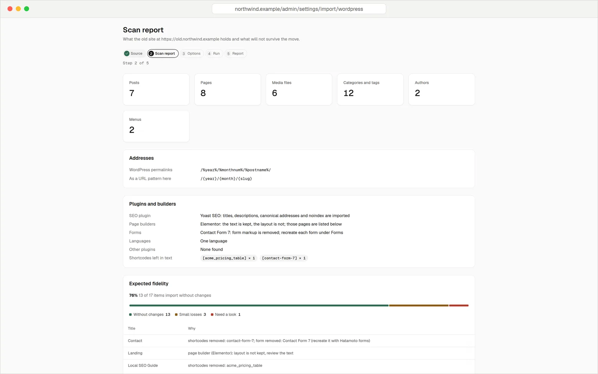</td>
    <td width="50%">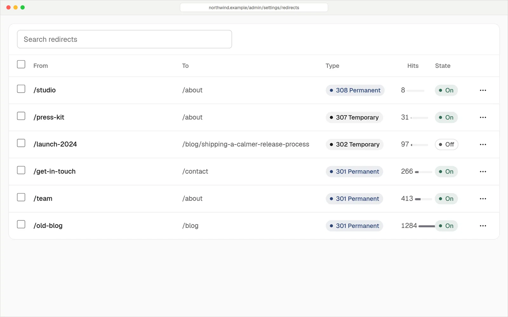</td>
  </tr>
</table>

### Plugins and updates you can trust

Plugins and themes are signed WebAssembly packages. Before you install one you see who signed it and every
permission it asks for, and the risky ones are off until you switch them on. Updates are signed too: they
install in your maintenance window, and a release that fails its health check rolls back on its own.
[Plugins](docs/site/plugins/index.md), [Updates](docs/site/updates/index.md)

<table>
  <tr>
    <td width="50%">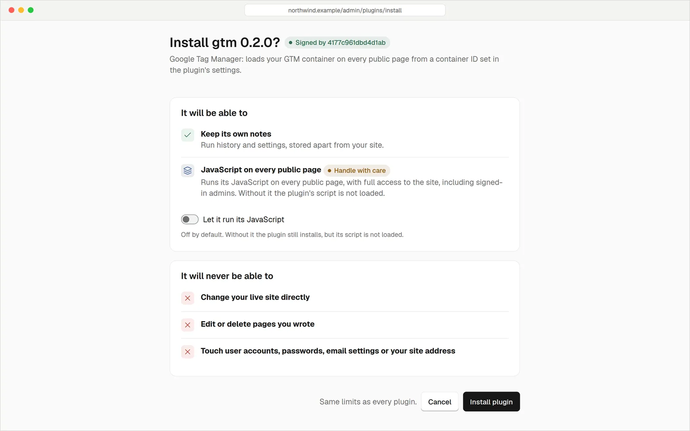</td>
    <td width="50%">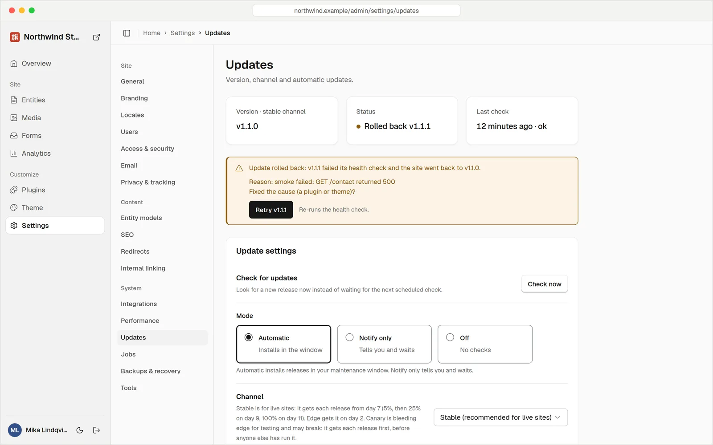</td>
  </tr>
</table>

<details>
<summary><strong>More: forms, menus, internal links, URL patterns, caching</strong></summary>
<br>

<table>
  <tr>
    <td width="50%">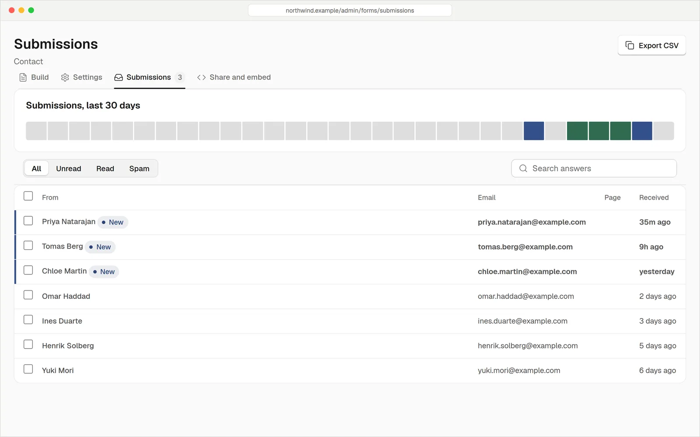<br><sub>Forms with a spam filter and CSV export. <a href="docs/site/admin/forms.md">Forms</a></sub></td>
    <td width="50%">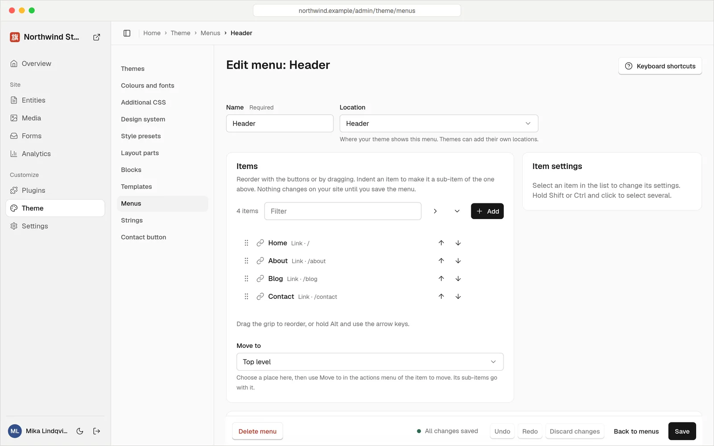<br><sub>Menus, edited and previewed in the admin. <a href="docs/site/admin/media-menus-redirects.md">Menus</a></sub></td>
  </tr>
  <tr>
    <td width="50%">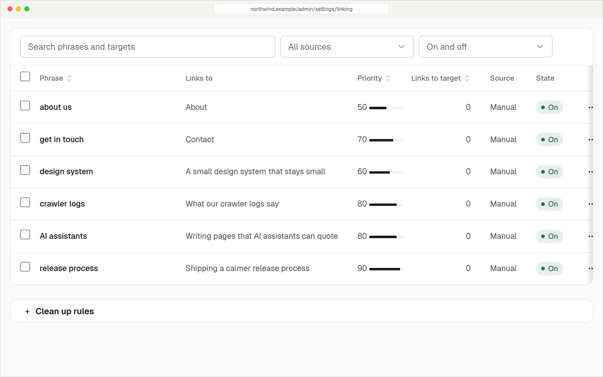<br><sub>Internal linking rules that turn phrases into links. <a href="docs/site/admin/settings-users-email.md">Settings</a></sub></td>
    <td width="50%">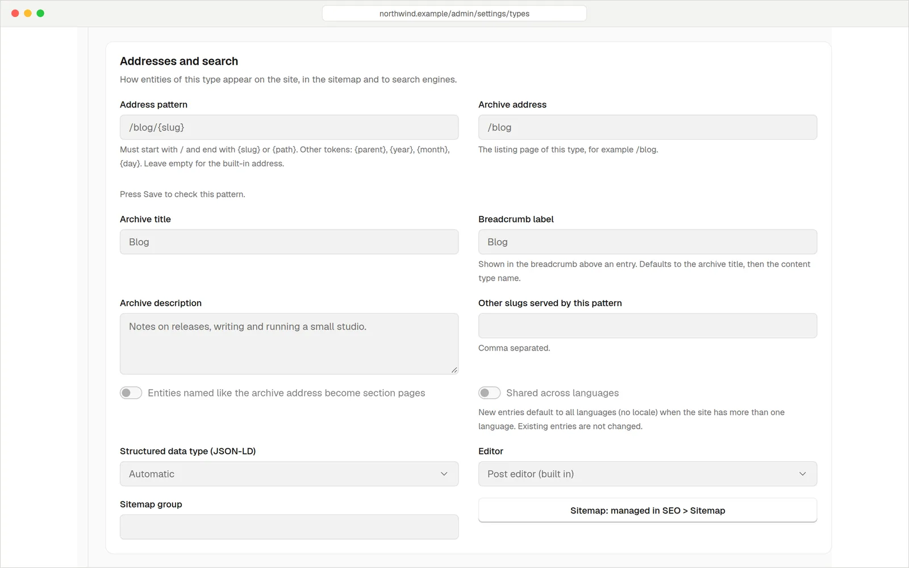<br><sub>Addresses are patterns you set per content type. <a href="docs/site/ai-seo/url-patterns.md">URL patterns</a></sub></td>
  </tr>
  <tr>
    <td width="50%">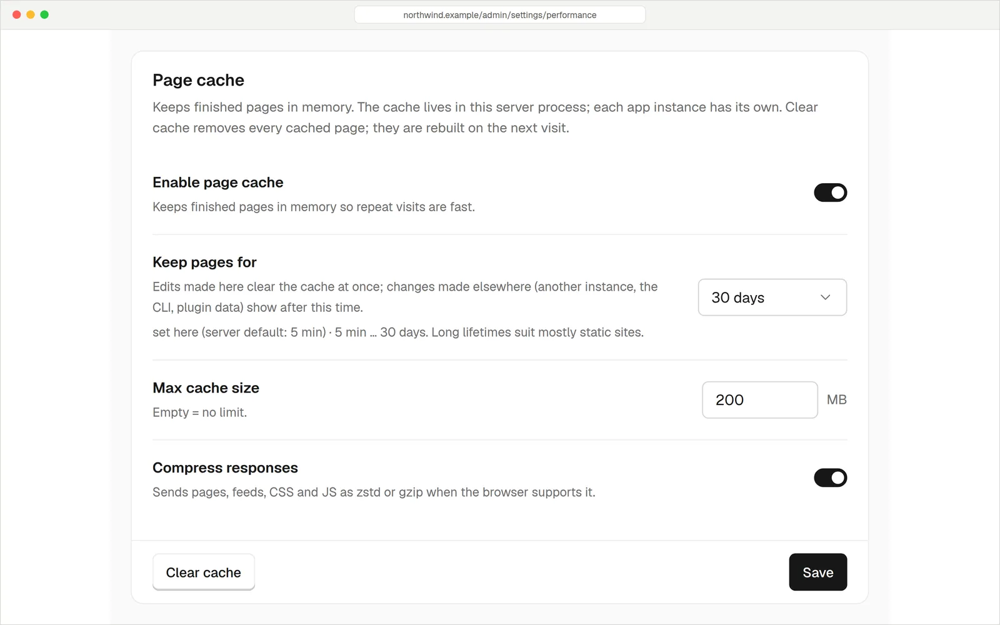<br><sub>A page cache and compression built in. <a href="docs/site/admin/performance-cache.md">Performance</a></sub></td>
    <td width="50%">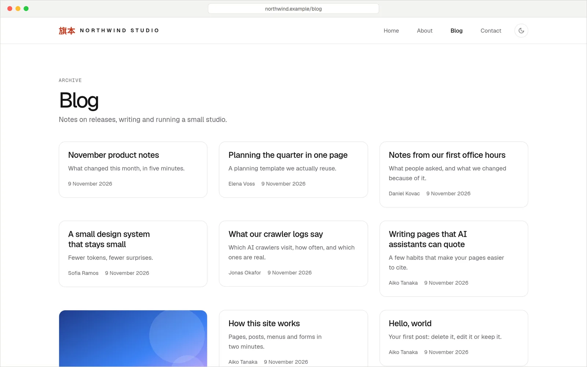<br><sub>The built-in theme, light and dark. <a href="docs/site/themes/index.md">Themes</a></sub></td>
  </tr>
</table>

</details>

### Themes

Themes are signed packages too. Install one, then change its colours, fonts and layout parts from the admin
without touching code. [Browse themes](https://hatamoto.dev/themes), [Write a theme](docs/THEMES_WRITE_AND_SUBMIT.md)


## Features

- A fast, server-rendered site with a good default theme, a blog and pages.
- A proper **blog editor** and a visual **page editor**. [Admin guide](docs/site/admin/index.md)
- **WordPress import** that keeps every old URL working, with a URL audit. [Move your site](docs/site/migrate-contribute/wordpress-import.md)
- **AI-crawler analytics** (which AI read which page, and did it send visitors), `llms.txt`, JSON-LD and a knowledge graph. [AI and SEO](docs/site/ai-seo/index.md)
- Sandboxed one-click **plugins** and **themes** (WebAssembly), nothing to compile. [Plugins](docs/site/plugins/index.md), [Themes](docs/site/themes/index.md)
- An **MCP server**, so AI agents can write and publish through the CMS. [MCP](docs/site/ai-seo/mcp.md)
- Signed releases with automatic updates you control. [Updates](docs/site/updates/index.md), [docs/UPGRADES.md](docs/UPGRADES.md)

## How it fits together

One program, `hatamoto`, and one Postgres database. The site, the admin, the JSON API, the MCP endpoint,
background jobs and the plugin runtime all run in that one process: no Node, no Redis, no search server,
no separate worker. [Architecture](docs/site/architecture/overview.md)

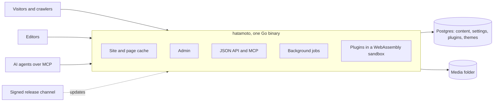

## Run it in production

| Topic | Read |
| --- | --- |
| Hardening (HTTPS, HSTS, CSP, secrets, SMTP) | [Hardening](docs/site/operate/hardening.md) |
| Every environment variable | [Configuration reference](docs/site/operate/configuration-reference.md) |
| Every `hatamoto` command | [CLI reference](docs/site/operate/cli-reference.md) |
| Reverse proxy and TLS | [Reverse proxy and TLS](docs/site/operate/reverse-proxy-tls.md) |
| systemd or Docker | [Deploy with systemd](docs/site/operate/deploy-systemd.md), [Deploy with Docker](docs/site/operate/deploy-docker.md) |
| Backups and updates | [Backups](docs/site/operate/backups.md), [Updates](docs/site/updates/index.md) |

Anonymous install stats are on by default and one switch turns them off. The one install report is Detailed once setup is finished unless an owner chooses Basic or Off, and `HATAMOTO_TELEMETRY=off` rules it out. Every connection the server makes, with the switch that turns it off, is listed in
[Outbound connections](docs/site/operate/outbound-connections.md). Updates can stop entirely: set `HATAMOTO_UPDATES`
to `off` (no network call at all).

## Contribute

Go is the only toolchain: `make build`, `make check`, and `go test ./...` from `backend/`.
Read [CONTRIBUTING.md](CONTRIBUTING.md) and the [Code of Conduct](.github/CODE_OF_CONDUCT.md), and report security
problems privately as described in [SECURITY.md](SECURITY.md). Write a plugin: [plugin guide](docs/PLUGINS_WRITE_AND_SUBMIT.md);
write a theme: [theme guide](docs/THEMES_WRITE_AND_SUBMIT.md).

## Licence

[Apache-2.0](LICENSE). Copyright Zen Labs Corporation; third-party components in [NOTICE](NOTICE).
"Hatamoto" and its logo are trademarks of Zen Labs Corporation: forks must use a different name.
See [TRADEMARKS.md](TRADEMARKS.md).
